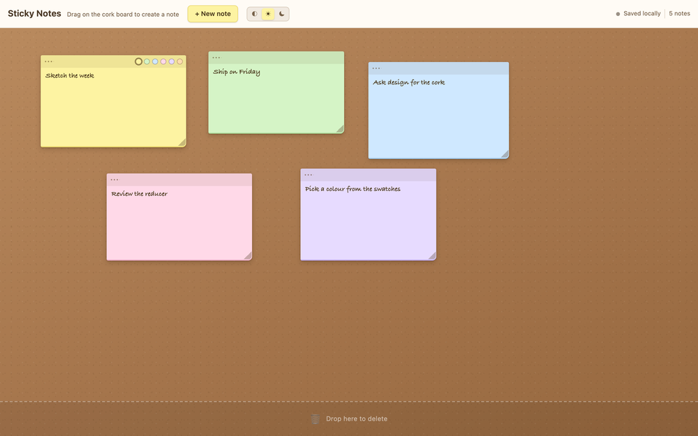
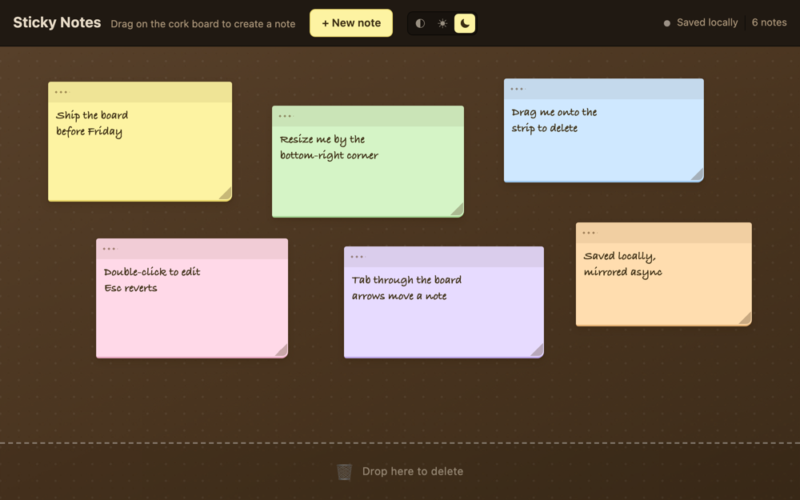

# Sticky Notes

A cork board for sticky notes that behaves the way paper does: **draw** a note anywhere, **drag** it
around, **resize** it from the corner, **edit** it, **recolor** it and **throw it in the bin** — with
undo.

Every gesture is hand-written with Pointer Events and a plain reducer: **no drag-and-drop library, no
state library, no UI kit**. React DOM is the only runtime dependency.

<p>
  
  
  
  
  
  
</p>


*Draw to create · drag to move · corner to resize · double-click to edit · drop on the strip to delete
· undo for six seconds.*

```bash
bun install
bun run dev        # http://localhost:5173
```

Drag on the cork board to make your first note. Everything else is discoverable from there.

## Features

| # | Feature | How it works |
|---|---|---|
| 1 | **Create at a position and size** | Press on empty board space and drag: a preview follows the pointer and the note is created with exactly that geometry. A plain click drops a default 240×160 note; **+ New note** uses the next free cascading slot. |
| 2 | **Resize** | Bottom-right corner handle, top-left anchored, 120×60 minimum, never larger than the board. |
| 3 | **Move** | Press anywhere on the note and drag. Pointer capture keeps it following the cursor outside the element and outside the window. |
| 4 | **Delete by dragging to the bin** | The strip arms when a drag starts, the note physically enters it, both turn red, and the drop deletes — with a six-second **Undo**. |

Also in: **inline text editing** (blur or `⌘`/`Ctrl`+`Enter` saves, `Esc` discards) · **bring to
front** on press · **localStorage persistence** that survives reloads and refuses to crash on invalid
or blocked storage · **six pastel colours** · **a three-way theme control** (system, light, dark) that
remembers the choice and applies it before the first paint · **an async REST mirror** that reports
syncing, synced and failed, and offers Retry.

The edge cases are the part worth reviewing: `Esc` cancels a move or resize and restores the exact
previous geometry, a note dragged over the bin and back out is kept, every note is clamped inside the
board — including after the window shrinks — and a note released on the strip but outside the bin
snaps back above it.

## Pointer and keyboard

The board is fully operable without a mouse.

| Action | Pointer | Keyboard |
|---|---|---|
| Create | Drag on empty board · click · **+ New note** | `Tab` to **+ New note**, `Enter` |
| Focus | Press the note (also raises it) | `Tab` / `Shift+Tab` in stacking order |
| Move | Drag the note | Arrow keys, 8 px |
| Resize | Drag the bottom-right corner | `Shift` + arrows, 8 px |
| Edit | Double-click · `Esc` reverts · `⌘`/`Ctrl`+`Enter` saves | `Enter` / `F2`; `Esc` leaves and returns focus |
| Recolor | Hover, click a swatch | `Tab` into the palette, arrows to change, `Space`/`Enter` |
| Delete | Drag onto the strip | `Delete` / `Backspace` (focus moves to the neighbour) |
| Cancel a gesture | `Esc` | `Esc` |
| Theme | System · Light · Dark in the toolbar | `Tab` to it, `Enter` |

Notes are focusable groups with a visible ring, an accessible name built from their text, a role
description and their shortcuts announced. The palette is a real radio group — one tab stop, arrow
keys — deleting hands focus to the neighbouring note, and the sync status announces itself from its own
live region, so a screen reader is not told the note count on every save. `eslint-plugin-jsx-a11y` is
part of the lint gate, not a good intention.

## Light and dark

Three explicit options in the toolbar: **System** follows the OS (and reacts to a live change),
**Light** and **Dark** override it. The choice is remembered under `sticky-notes-theme-v1`, kept out of
the board payload so a theme change never triggers a save or a sync.

The palette is resolved in one place — `app/theme.ts` turns a preference plus the system scheme into
`data-theme="light|dark"` on the document root, and the stylesheet keys two token blocks off that
attribute instead of duplicating a `prefers-color-scheme` copy. A short inline script in `index.html`
applies the stored preference before the bundle boots, so a reload never flashes the wrong theme.

| Light | Dark |
|---|---|
|  |  |

## Architecture

**Pure rules → state → view, one direction.** `domain/note.ts` holds the model and every geometry rule
as pure functions: normalise a drag rectangle, enforce sizes, clamp to bounds, hit test, find a free
slot. `app/store.ts` is a reducer over `{ notes, zCounter }` where a monotonic counter — not array
order — decides stacking, and an action that changes nothing returns the same state object, so it costs
no render, no write and no sync. `app/NotesProvider.tsx` owns the single store: it hydrates from
`localStorage` in the reducer's lazy initialiser and derives both the debounced write and the
serialised sync from the state itself, so rapid edits coalesce instead of racing.

**Three contexts, not one.** State, dispatch and sync are separate providers. `dispatch` never changes
identity, so a note that only dispatches does not re-render when another note moves — something `memo`
alone cannot do, because a single context object changes on every action.

**Geometry is measured, never declared.** `app/boardGeometry.ts` reads the board and the strip from the
DOM and derives the usable area from the strip's own top edge, so the stylesheet is the only place that
height exists and hit testing cannot drift from what is on screen.

**One drag engine, three sessions.** `hooks/useDrag.ts` opens a pointer session on a primary
`pointerdown`, captures the pointer, listens on `window` and cancels on `Esc`; it tears everything down
if its host unmounts mid-gesture. `hooks/useNoteGestures.ts` turns that into create, move and resize,
each with the geometry snapshot taken at `pointerdown` — which is why cancelling restores exact values
instead of recomputed ones. Keyboard actions call the same clamping helpers, so the two input paths
cannot drift apart.

```
pointer / keyboard
       │
       ▼
    Board ─────────────► reducer (pure rules) ─────► NotesProvider
 (gestures, hit test)                                 ├─ localStorage  authoritative, validated
       │                                              └─ NotesApi      async, serialised
       ▼
 Note · TrashZone · Toolbar   ◄── rendered from state only, never mutated
```

| Layer | Lives in | Rule it keeps | Covered by |
|---|---|---|---|
| Domain and state | `domain/note.ts`, `app/store.ts` | Pure functions and a reducer: no DOM, no React | 32 unit tests |
| Geometry and input | `app/boardGeometry.ts`, `hooks/`, `components/Board.tsx` | Measured once per gesture; one engine, three sessions | 11 + 45 tests |
| Infrastructure | `infra/persistence.ts`, `infra/mockApi.ts` | Storage never throws at the app; the API is an interface | 15 unit tests |
| Preferences | `app/theme.ts`, `app/useTheme.ts`, `components/ThemeToggle.tsx` | Resolved once, written to the root, read back by the control | 11 + 4 tests |
| View | `components/`, `index.css` | Renders state, reports intent; no note data in the DOM | 9 tests |

```
src/
  domain/note.ts              Note model, palette, geometry rules
  app/store.ts                Reducer and actions (single source of truth)
  app/notesContext.ts         State / dispatch / sync contexts
  app/NotesProvider.tsx       Hydration, debounced persistence, serialised sync, retry
  app/boardGeometry.ts        Measures the board and the strip
  app/theme.ts                Theme preference: parse, resolve, persist, apply
  app/useTheme.ts             Hydrates the preference, follows the OS in System mode
  hooks/useDrag.ts            Pointer-capture drag engine
  hooks/useNoteGestures.ts    Create, move and resize as session factories
  components/Board.tsx        Composition: store, undo, focus, keyboard, layout
  components/Note.tsx         Rendering, editing, palette, keyboard map
  components/Toolbar.tsx      New note, theme control, sync status, note count
  components/ThemeToggle.tsx  Three-option radiogroup
  components/TrashZone.tsx    The drop strip
  components/ErrorBoundary.tsx  Recoverable screen instead of a blank page
  infra/                      localStorage adapter + REST mock
  test/                       jsdom stubs and the shared board harness
e2e/                          Playwright suite, run against the production build
scripts/doc-assets.mjs        Regenerates the screenshots and the demo GIF
openspec/                     Capability specs and the archived change history
```

## Testing

```bash
bun run test        # 127 unit and interaction tests (jsdom)
bun run test:e2e    # 60 browser scenarios: 30 × Chromium and Firefox
bun run lint        # ESLint: react-hooks, react-refresh, jsx-a11y
bun run build       # tsc -b (strict) + vite build
```

The browser suite needs its engines once per machine: `bun run test:e2e:install`.

| File | Tests | Covers |
|---|---|---|
| `domain/note.test.ts` | 16 | Clamping, minimum and default sizes, rect normalisation, hit testing, free-slot search |
| `app/store.test.ts` | 16 | Every action, z-ordering, no-op actions, `clampAll`, hydrate, restore, frozen initial state |
| `components/board.interactions.test.tsx` | 39 | Pointer and keyboard flows end to end |
| `infra/persistence.test.ts` | 12 | Round-trip, schema and size validation, malformed JSON, throwing and blocked storage |
| `hooks/useDrag.test.tsx` | 7 | Deltas, movement outside the element, `Esc`, `pointercancel`, sequential sessions, unmount teardown |
| `index.css.test.ts` | 7 | PostCSS AST guard: no Sass-only nesting, a background per colour, strip height defined once, `sr-only`, crash screen |
| `components/board.regressions.test.tsx` | 6 | Escape-then-edit, palette radio group, stacking no-op, focus after delete, viewport clamp |
| `app/theme.test.ts` | 11 | Preference parsing with fallback, resolution against both schemes, storage that throws, root attributes |
| `components/theme.test.tsx` | 4 | System default, choice applied and stored, stored choice restored, corrupt value falls back |
| `app/boardGeometry.test.ts` · `infra/mockApi.test.ts` · `components/ErrorBoundary.test.tsx` | 4 · 3 · 2 | Measured geometry, async mock, crash screen |

The component suite runs through the **React Compiler**, exactly like the production build, so a
compiler bailout cannot hide until deploy.

`e2e/` builds the app, serves `vite preview` and drives real Chromium and Firefox at 1024×768 with
genuine pointer and keyboard input — the parts jsdom cannot see: layout, pointer capture, CSS and
cross-engine behaviour. The theme spec emulates the operating system's scheme, so "system", "override"
and "live change" are asserted against a real media query, not a stub. Selectors are `data-testid`-based
and interaction state is read from `data-*` attributes, so renaming a style class cannot break the suite. It asserts concrete numbers, so a
regression names the value that moved: create → `240×160` at `(120, 150)`, move → `+40/−30`, resize →
`300×190` with the top-left anchored, keyboard → `64,64 → 80,72`.

The media in `docs/` is generated the same way, not hand-cropped: `bun run docs:shots` and
`bun run docs:demo` drive the production build with Playwright and encode with ffmpeg, so the GIF in
this README is the app as it ships (`scripts/doc-assets.mjs`).

## Decisions

- **Draw-to-create** answers "position and size" as one gesture, with a preview before committing.
  Click and the toolbar button stay as discoverable fallbacks.
- **Bounds**: 240×160 default, 120×60 minimum, 8 px keyboard steps, notes always fully inside the
  board — no panning a larger canvas. A sticky note that scrolls away is not a sticky note.
- **Hit testing the bin by pointer position**, not by note overlap: the truthful target, and it
  behaves the same for tiny notes.
- **A single-slot undo** with a six-second window that pauses while you are on it. A generic undo stack
  would be more machinery than this app earns.
- **`localStorage` is authoritative, the REST mock is a mirror** behind an interface. No backend was
  required; pointing it at a real endpoint replaces one object.
- **Not coalescing `pointermove` with `requestAnimationFrame`**: it would break the synchronous
  contract the interaction tests and the mid-gesture visuals rely on. The cost was fixed at the source
  instead — a drag re-renders one note, not the board.
- **An error boundary wraps the app**, so a render throw (a blocked storage accessor, a bad payload)
  shows a recoverable screen instead of a blank page.
- **The theme is resolved in JavaScript, not in CSS** (`data-theme` on the root plus a pre-paint
  script). A media query cannot express a three-way preference, and duplicating the dark token block
  for the system case would encode the precedence rule twice.
- **Bun** as the toolchain, since the scaffold shipped `bun.lock`. The scripts are plain `vite`,
  `vitest`, `tsc` and `eslint`, so any package manager runs them.

## Context

Built as a front-end take-home: React + TypeScript + Vite, three required features and five optional
ones, no UI or drag-and-drop library. The rules the board obeys are written down as capability specs
under `openspec/specs/`, and each change that shaped them is archived with its proposal, design and
task record.

## License

No license file: this is assessment material, not a public library.
